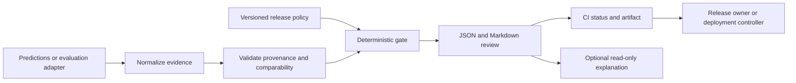

# MREG: Model Release Evidence Gate

Status: original planning baseline. A local MVP now exists; see README.md and docs/ for implemented behavior.
Research date: 2026-10-02.

## Product thesis

Help ML developers answer: **What changed, what evidence supports releasing this model, and which checks prevent it from moving forward?**

MREG should be an open-source Python library and CLI that turn candidate/baseline evaluation evidence and a versioned policy into a reproducible release review. It plugs into existing training, evaluation, registry, and CI tools. An optional assistant explains the evidence; deterministic code owns the verdict.

Keep the original separation between policy and agent. Shift the headline from an intelligent deployment agent to trustworthy, portable release evidence. Passing means eligible for the next configured review or staging step; it does not certify production safety.

## Who benefits first

Start with developers and small ML teams using Python, tabular classifiers, and CI who currently compare experiment metrics by hand or maintain custom threshold scripts. They should be able to try MREG using local files, without cloud accounts, Kubernetes, an LLM subscription, or an MLflow server.

Initial job: after producing candidate and baseline predictions on a fixed evaluation set, run one command and obtain an actionable report plus a CI status. Training remains the user's responsibility.

This audience and pain point are hypotheses, not validated demand. Before broadening scope, ask three to five developers to bring an existing release review and test whether this report reduces their review effort.

## What already exists

| Existing tool | Existing capability | MREG relationship |
|---|---|---|
| [MLflow evaluation](https://mlflow.org/docs/latest/ml/evaluation/) | Evaluation metrics and threshold validation, including baseline comparisons | Import evidence rather than build a competing registry |
| [TFX Evaluator](https://www.tensorflow.org/tfx/guide/evaluator) | Model evaluation and validation that can block downstream model pushing | Learn from its validation boundary; avoid claiming gating is new |
| [Evidently tests](https://docs.evidentlyai.com/docs/library/tests) | Tests over evaluation metrics with configurable conditions | Optional evidence adapter; do not rebuild its report ecosystem |
| [Argo Rollouts analysis](https://argoproj.github.io/argo-rollouts/features/analysis/) | Progressive delivery driven by analysis outcomes | Later consume an MREG outcome alongside operational checks |

The proposed contribution is the combination of a small integration footprint, evidence compatibility checks, explicit uncertainty handling, stable reason codes, and a portable release review. This is a positioning hypothesis based on documentation, not proof of a unique market gap. If a thin extension of an existing tool serves users better, prefer that over a standalone platform.

## Refactor the original architecture

| Baseline element | Revised role |
|---|---|
| Git push automatically trains | CI evaluates a specified candidate; training may be upstream or an example workflow |
| MLflow mandatory | Local evidence format first; MLflow adapter later |
| Aggregate accuracy/F1 and latency thresholds | Aggregate and named-slice checks, comparability, sample support, and declared uncertainty |
| LLM release analysis agent | Optional explanation of a completed decision, with evidence references |
| Pass leads to canary and automatic promotion | Pass produces an eligibility artifact; deployment controller and release owner control promotion |
| Kubernetes, Prometheus, Grafana | Optional later integration demo |
| Dashboard as product entry point | CLI, Python API, JSON and Markdown reports first; report viewer later |

## Architecture



The CLI should also replay a previously captured evidence bundle. Separate normalization, metric calculation, policy evaluation, reporting, and external integrations so each can be tested independently.

## First release: one narrow, useful workflow

Support binary tabular classification first, with a reproducible scikit-learn example. The core accepts normalized evidence; an example evaluator computes metrics from paired predictions. Users need not deserialize arbitrary models inside the gate.

Deliver:

1. A documented, versioned input schema for model identity, evaluation context, metrics, slices, and benchmark measurements.
2. A declarative YAML policy with absolute floors/ceilings, baseline-relative regression limits, and minimum sample requirements. No executable expressions in policy files.
3. Evidence validation before any eligibility decision.
4. Deterministic verdicts with stable reason codes and per-check evidence references.
5. A JSON result for automation and Markdown review for humans.
6. A GitHub Actions example that uploads the review and blocks progression on every non-pass outcome.
7. Runnable examples for pass, hard failure, and insufficient evidence.

Proposed commands, not implemented APIs:

```text
mreg check --evidence evidence.json --policy release-policy.yaml --output review/
mreg replay --bundle review/bundle.json --output replay/
```

Proposed exit contract: 0 = PASS, 1 = FAIL, 2 = INSUFFICIENT_EVIDENCE, 3 = ERROR. CI permits progression only for 0; reports distinguish policy failures from invalid inputs and operational failures.

## Evidence contract

Record at least:

- Schema version, evidence ID, collection time, and evaluator version.
- Candidate and baseline artifact digests, immutable model versions, source revision, and relevant configuration identity.
- Dataset version/fingerprint, split, label definition, positive class, prediction threshold, and metric definition/averaging.
- Pairing keys or a fingerprint of the evaluated example IDs; both models must use the same labeled examples for paired comparison.
- Aggregate and slice metrics, slice definition, sample counts, and class support. Undefined metrics remain undefined, never silently zero.
- Benchmark context: hardware, runtime, workload, concurrency, batch size, warm-up procedure, measurement repetitions, and latency statistic/units.
- Policy digest and all evidence references consumed by the decision.

Distinguish computed evidence from imported, externally asserted evidence. A content hash establishes identity, not authenticity or honest measurement. Start with a trusted CI producer; do not claim tamper-proof evidence. Signing/attestation is a separate later feature.

Reject incompatible or unsupported schema versions. Missing values, NaN/infinity, unit mismatches, conflicting metric definitions, and incomparable contexts must never produce PASS. Record which checks were not evaluated and why.

Resolve mutable registry aliases to immutable versions before evaluation. Bind eligibility to candidate digest, baseline digest, policy digest, and evidence digest. A deployment integration must re-check these identities; replacing the artifact after review invalidates eligibility.

## Policy and verdict semantics

| Verdict | Meaning | Typical trigger |
|---|---|---|
| PASS | All required checks have adequate, compatible evidence and satisfy policy | Quality and operational checks pass |
| FAIL | At least one required check has valid evidence showing a policy violation | Comparable p95 latency exceeds its ceiling |
| INSUFFICIENT_EVIDENCE | No demonstrated violation, but at least one required check cannot be established | Required slice missing or too small |
| ERROR | Inputs are malformed, policy is invalid, or execution failed | Unsupported schema or unreadable artifact |

Validate structural inputs first. For valid bundles, a demonstrated required violation gives FAIL even if another check lacks evidence; preserve both findings. Otherwise incomplete evidence gives INSUFFICIENT_EVIDENCE. Only complete compliance gives PASS. Warnings are explicitly non-blocking and do not substitute for required checks.

Example policy requirements, illustrative rather than universal defaults:

- Candidate aggregate F1 at least 0.90.
- Aggregate F1 regression no greater than 0.01 absolute score units, i.e. one percentage point.
- Recall regression no greater than 0.02 for a named, predeclared slice with enough positive examples.
- Comparable inference p95 latency at most 60 ms.
- Candidate artifact size at most a configured byte limit.

Do not mix percentage points with relative percentages. Define metric direction, comparison operator, inclusive boundary behavior, and units in the schema. Relative change against a zero baseline is undefined and requires an explicit alternative rule.

Policies are reviewed code. Evaluate against the trusted target-branch policy in CI; a candidate PR must not silently weaken its own required checks. Intentional policy changes need a separate visible review, with the old and new decisions shown when feasible.

## Statistical discipline

A threshold comparison is deterministic but does not prove a change generalizes. Make the uncertainty boundary visible rather than attaching a generic confidence score.

For the paired-prediction example, implement a documented paired bootstrap of metric differences with a fixed seed and recorded configuration. For a higher-is-better metric with allowed regression d, require the lower confidence bound of candidate-minus-baseline to be at least -d when that statistical check is enabled. Evidence beyond the permitted regression produces FAIL; overlapping bounds produce INSUFFICIENT_EVIDENCE. Keep point-estimate and interval checks separate and document their precedence.

Imported aggregate metrics cannot support a paired interval unless the producer also supplies the required validated evidence. The first increment can ship declared point-estimate policies, but must describe their weaker guarantee. Do not claim statistical validation until the interval implementation is tested.

Predeclare slices and minimum class support. Document the effect of testing many slices and repeated evaluation against the same holdout; bootstrap intervals alone do not resolve multiple comparisons or test-set overfitting. Avoid claims of formal release guarantees.

## Example review

Illustrative numbers, not measured results:

```text
Verdict: FAIL
Aggregate F1: 0.912 -> 0.931 (+1.9 percentage points)
Inference p95 latency: 40 ms -> 87 ms
Required latency ceiling: 60 ms
Reason: LATENCY_CEILING_EXCEEDED
Evidence: benchmark.candidate.p95_ms
Next step: profile inference and rerun the same benchmark context.
```

A second demo should improve aggregate F1 while regressing on a named slice. A third should have a promising candidate but insufficient slice support. These demonstrate why the project helps beyond a happy-path MLOps diagram.

## Optional assistant

Start with deterministic report templates. Add an LLM only after users can complete the workflow without it.

The assistant receives the structured result and permitted evidence. It can explain failed checks, identify missing evidence, and suggest next investigations. It cannot alter policies, issue authoritative eligibility, promote models, or access deployment credentials. Every factual claim should point to a result field or evidence ID.

Treat model descriptions, imported reports, registry metadata, and logs as untrusted data. The explanation must not execute instructions found inside them. Escape untrusted content in rendered reports, redact secrets, and minimize data sent to external providers. Raw features and labels are local by default.

When explanation generation times out or returns unsupported claims, preserve the original verdict and fall back to the deterministic report. Evaluate citation correctness, numeric fidelity, contradictions of the verdict, injected instructions, and graceful failure before shipping this feature.

## Scope boundaries

Defer automatic training orchestration, hosted dashboards, authentication/multitenancy, universal model support, online traffic routing, automatic rollback, and custom monitoring infrastructure. Also defer LLM/RAG evaluation: its datasets, judges, and uncertainty need a separate task-specific design.

Later canary integration must define minimum traffic, observation windows, metric freshness, error budgets, and an inconclusive outcome. Live accuracy/F1 requires labels and may arrive late; prediction-distribution drift is a signal, not proof of quality loss. Rollback remains a controller operation with a pinned previous artifact and an exercised recovery path.

## Learning path and acceptance milestones

| Milestone | Learning value | Acceptance evidence |
|---|---|---|
| 0: Validate the problem | Product scoping and developer interviews | Three to five reviews of real workflows; written adoption blockers |
| 1: Local gate | Python packaging, schemas, policy design | Same normalized inputs produce the same decision; missing required evidence blocks |
| 2: Paired evaluation | Metrics, experimental design, uncertainty | Same-set comparison; known regression fixtures; tested interval behavior |
| 3: CI release review | CI artifacts and trust boundaries | Real workflow blocks a regression, pins evidence, and publishes a review artifact |
| 4: MLflow adapter | Integration design and provenance | Resolves immutable versions; matches local decision for equivalent evidence |
| 5: Community pilot | Documentation and API usability | Three external developers complete an existing-model review; blockers are recorded |
| 6: Optional explanation/MCP | Tool design and agent evaluation | No verdict changes; referenced claims; injection and failure cases |
| 7: Canary example | Deployment and observability | Staging-only demo exercises promotion, inconclusive analysis, and rollback |

Tests should cover inclusive threshold boundaries, metric direction and units, undefined/invalid values, zero baselines, absent slices, low support, context mismatches, policy changes, replay parity, and assistant failures when that module exists. Adapters need parity tests rather than only mocked happy paths.

Define success by adoption effort and useful review decisions, not component count. Proposed targets: documented local demo in under 15 minutes, no mandatory external service, stable machine-readable output, and successful pilot integrations. These are targets to measure, not current achievements.

## Community strategy

Publish a practical library before a platform. Include one genuinely runnable example, a regression gallery, policy recipes with clearly stated limits, and an adapter guide. Ask early adopters which pieces of their existing workflow they want to keep.

Choose an explicit OSI-approved license before public distribution, confirm dependency/data license compatibility, document supported Python and integration versions, and maintain a changelog and schema migration policy. Good first issues can focus on documentation, additional fixtures, policy recipes, and evidence adapters.

## Decisions still open

- Validate whether target users prefer a standalone CLI or an extension to an existing evaluator.
- Select a permissive license and supported Python versions when implementation begins.
- Pick the first non-demo dataset with suitable redistribution terms and meaningful slices.
- Define sample-size and uncertainty policies with the actual task owner; avoid universal thresholds.
- Choose whether an optional assistant materially improves the report based on user testing.

The existing DESIGN.md is a visual reference only. It should guide a future viewer if needed, not drive the architecture or MVP scope.
