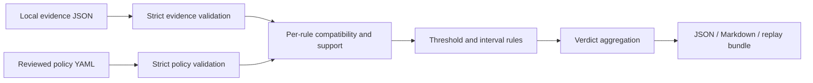

# Architecture

MREG 0.1.0 is a local library and CLI with a src-layout Python package. Runtime
dependencies are Pydantic 2 and PyYAML. NumPy/scikit-learn belong to the optional
evaluation extra; the core imports neither. The CLI uses the standard-library
argparse rather than adding Typer/Click for two commands.

`models/` contains public versioned contracts. `evidence/` owns parsing/compatibility;
`policy/` owns safe loading and numeric comparisons; `gate/` owns checks and verdicts;
`reporting/` owns local artifacts; `metrics/` owns optional paired evaluation;
`adapters/base.py` defines the conversion protocol. Small functions replace extra
normalizer or rule-class hierarchies.

Validate structural inputs first: invalid schema, nonfinite numerics, unknown fields,
invalid support counts, or invalid policy produce ERROR. Missing/null measurements
and valid-but-incompatible evidence produce per-check INSUFFICIENT_EVIDENCE.
Run all rules and preserve their findings. Among required checks, ERROR takes
precedence over FAIL, then INSUFFICIENT_EVIDENCE, then PASS. Warning-only failures
are shown but do not block eligibility. Policies must contain a required rule.

Compatibility is scoped. Classification checks require matching datasets, splits,
labels, example fingerprints/counts, positive class, threshold, and metric semantics.
Latency requires comparable benchmark contexts and units. Artifact size does not
depend on dataset compatibility. A valid size failure still blocks release even if
quality comparisons are inconclusive.

No network calls, model deserialization, instruction execution, deployment, or LLM
verdicts occur in the core. Identity hashes bind content, not truthful collection.
Replay requires matching normalized input digests and decision semantics. Reports
contain no runtime-generated timestamps, so identical normalized inputs produce
identical output. Collection timestamps are input provenance.

Implementation choice: percentages in policies use explicit `percentage_points`
(1 means 0.01 score) or `relative_percent` (1 means 1%). Decimal comparisons avoid
introducing an undocumented epsilon around threshold boundaries.

The CLI limits input sizes and avoids echoing raw exceptions/invalid inputs.
Output directories are caller-selected local paths; reports are not a sandboxed
file service. ERROR bundles are non-replayable and overwrite any stale bundle.
